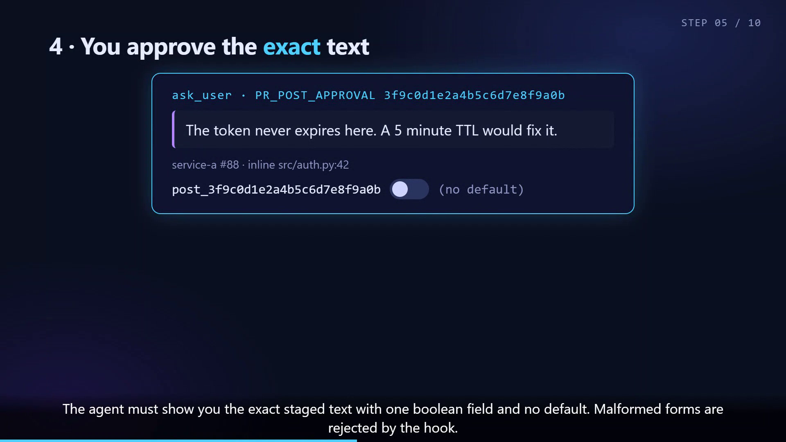

# docs/pr-post-gate — opt-in PR comment posting (animated)

[](pr-post-gate.mp4)

A short animated walkthrough of how `review-orchestrator` posts PR comments
**only** when you opt in and approve the exact text:

1. Default review is read-only. Posting is OFF.
2. `--post-comments=true` in *your* prompt enables staging + approval (never auto-post).
3. `pr_comments.py stage` humanizes, lints (slophound, no hyphens/semicolons) and
   grounds the text, then prints an `APPROVAL_TOKEN`.
4. `ask_user` shows the exact text with Post, Edit text and Skip choices, no default.
5. Post makes `pr-post-gate-hook.py` mint a one-use, 15-minute,
   target-bound HMAC grant.
6. `pr_comments.py reply|comment --approval <t>` consumes the grant and posts the staged text.
7. Bypasses (raw `curl`/`gh api`/`az` writes, forged or replayed tokens, edited text,
   agent self-opt-in, reading the signing key) are denied.

Edit text discards the old stage and collects your replacement wording. The agent
stages it for the same PR/target, reruns the text checks and asks for fresh approval.
Editing alone never posts. Skip or cancellation also posts nothing.

Current helpers require a related diff file and line for every new comment.
Generic posting is disabled. All authors' open comments/tasks are checked for
matching coverage before staging and again before posting, so existing manual
items are not duplicated.

The recorded animation demonstrates the earlier Yes/No form, which is still
supported. Current comment forms offer Post/Edit text/Skip as described above.

## Files

| File | What it is |
|------|------------|
| `pr-post-gate.html` | The animation. Self-contained, autoplays in a browser. |
| `pr-post-gate.mp4`  | Rendered 1080p H.264 (≈1:30, 30fps, silent, on-screen captions). |
| `poster.png`        | Still frame used as the README thumbnail. |

## Re-render

Same protocol as [`docs/flow`](../flow/README.md) (`window.__ready` / `__start()` /
`__done`). Use the `record.mjs` snippet from that README:

```
node record.mjs pr-post-gate.html pr-post-gate.mp4
ffmpeg -y -ss 40 -i pr-post-gate.mp4 -frames:v 1 poster.png
```
